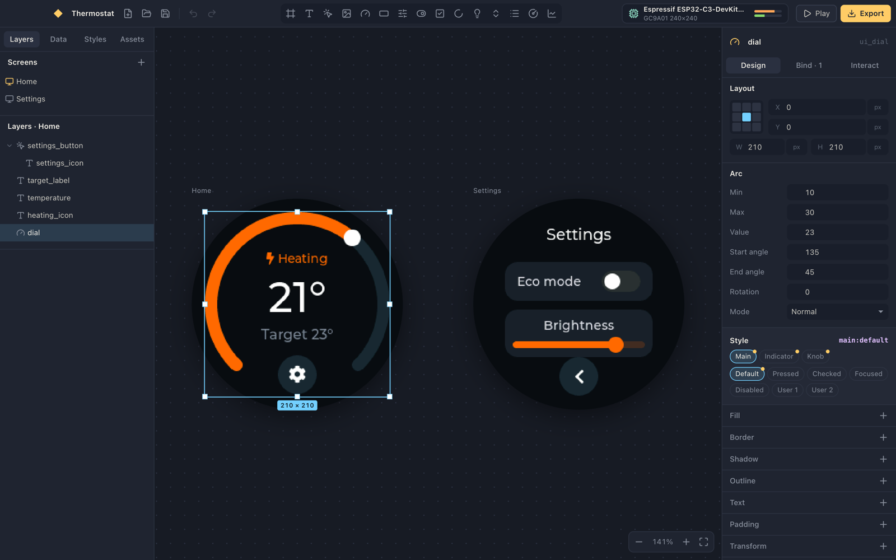
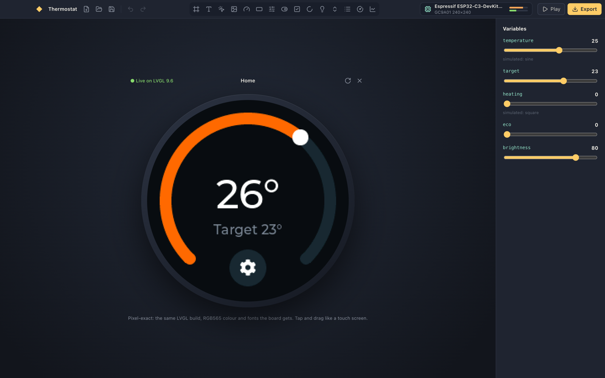

# Kiln

A Figma-style editor for microcontroller UIs. You design on an infinite canvas, wire widgets to
data coming off the board, and export plain LVGL 9.6 C inside a PlatformIO project that builds for an
ESP32-C3 with no edits.



The canvas isn't an imitation of LVGL: it **is** LVGL. Version 9.6 is compiled to WebAssembly and
renders every artboard, at the panel's RGB565 colour depth, with the fonts and theme the board gets.
What you see is what flashes.



## What it does

- **Design like Figma.** Screens sit side by side on an infinite canvas. Insert widgets, drag with
  smart guides, resize from any handle, nest with auto layout (flexbox), group, copy and paste, undo
  everything. Click picks the top-level layer, double-click goes deeper, ⌘-click goes deepest.
- **Style like CSS.** Every LVGL style property, per part (`indicator`, `knob`…) and per state
  (`pressed`, `checked`… and combinations like `checked+pressed`). Shared styles work like classes,
  colour tokens like CSS variables, and transitions like `transition:`.
- **Animate like the web.** Keyframe timelines with `cubic-bezier` easing, delays, repeat and
  alternate, started when a screen loads or when something is tapped.
- **Bind to the board.** Variables are LVGL subjects. Bind text, values, checked state, visibility,
  states, chart history, or any numeric style property mapped from one range to another. Feed a
  variable from an ADC pin, a digital pin, uptime, free heap, the chip's temperature or any C
  expression; let one drive a GPIO or PWM. Pins are checked against the MCU: ADC capability,
  strapping, flash and USB pins, double use.
- **Play it.** Play mode runs the whole UI on real LVGL: taps, events, screen transitions,
  animations, and simulated sensors you can scrub.
- **Export it.** `ui.h`, `ui.c` and one file per screen in readable LVGL C, an `lv_conf.h` with only
  the fonts you used, a LovyanGFX panel config, the hardware glue, and a `platformio.ini`. Your code
  goes in `src/app.cpp`, which Kiln writes once and never touches again.
- **Know if it fits.** A flash and RAM meter estimates the build against the board's real limits,
  read from PlatformIO's board definitions.

## Getting started

You need Node 22+, pnpm, and Rust (for the Tauri shell).

```sh
pnpm install
pnpm tauri dev      # the desktop app
pnpm dev            # or just the editor, in a browser at localhost:1420
```

[PlatformIO Core](https://platformio.org/install/cli) is optional. With it, the board list comes
from your installed PlatformIO, and Export can build and flash straight from the app. Without it,
Kiln uses a bundled snapshot of PlatformIO's ESP32, RP2040 and SAMD boards.

## How it fits together

```
document (zustand + immer) ──compile()──► op list ──► wasm LVGL     (the canvas and Play)
                                                  └─► C printer    (the export)
```

One function, `compile()` in `src/entities/project/lib/compile.ts`, turns the document into a list of
LVGL calls. The preview executes that list on LVGL in WebAssembly; the exporter prints the same list
as C. The canvas and the firmware can't drift apart because they're the same instructions.

The small amount of glue both sides need (colour and style animations, mapped bindings, chart
history) lives in `runtime/kiln_helpers.c`, which is compiled into the preview and copied into every
export.

The frontend follows [Feature-Sliced Design](https://feature-sliced.design), checked by Steiger:

| Layer | What's there |
|---|---|
| `app` | entry point, global styles |
| `pages/editor` | the editor layout and keyboard shortcuts |
| `widgets` | canvas, layers, inspector, data, styles, assets, timeline, player, dialogs |
| `features` | insert widget, node actions, history, project files, firmware export |
| `entities` | `project` (document, compiler, preview), `board` (PlatformIO boards, pins, budget), `editor` (selection, view) |
| `shared` | `lvgl` (catalog, ops, wasm runtime, C printer), `ui` kit, Tauri bridge |

Each slice is MVVM: views in `ui/` stay dumb and read a view-model hook in `model/` (for example
`useCanvas`, `useInspector`, `useLayers`), which is the only thing that talks to the stores.

## The LVGL runtime

`src/shared/lvgl/runtime/kiln-rt.wasm` is checked in, so you don't need a C toolchain to work on the
editor. To rebuild it (after adding a new LVGL constant to the TypeScript, say):

```sh
pnpm runtime
```

That fetches LVGL 9.6.0 into `runtime/lvgl` and compiles it with clang's `wasm32` target. It doesn't use
Emscripten: LVGL's built-in allocator, string and printf functions mean it needs no libc. It links
with `wasm-ld`, or with the `rust-lld` every rustup toolchain ships.

## Checks

```sh
pnpm check                 # typecheck, Steiger, and the vitest suite
cd src-tauri && cargo test # the Rust file-writing guards
```

The suite runs the sample project on the real wasm LVGL (bindings, taps, screen loads), and compiles
the exported C against the LVGL 9.6 headers with clang.

## Status

See [GOALS.md](GOALS.md). The export compiles for `esp32-c3-devkitm-1`, but nothing has been flashed
to a real panel yet. Display init (inversion, colour order, offsets) is the first thing to check on
hardware, and every one of those settings is a toggle in the board dialog.
