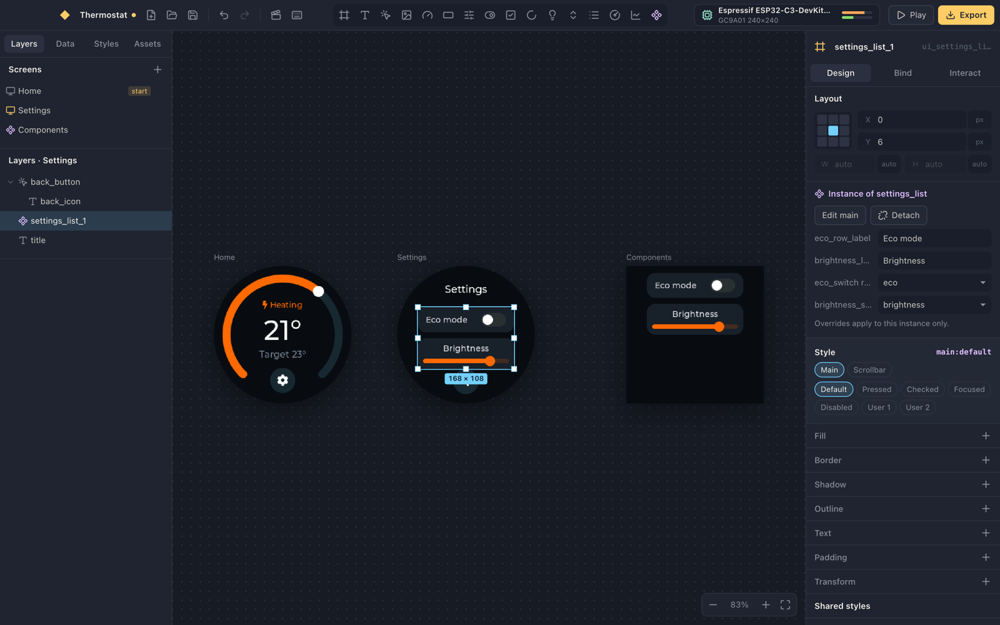
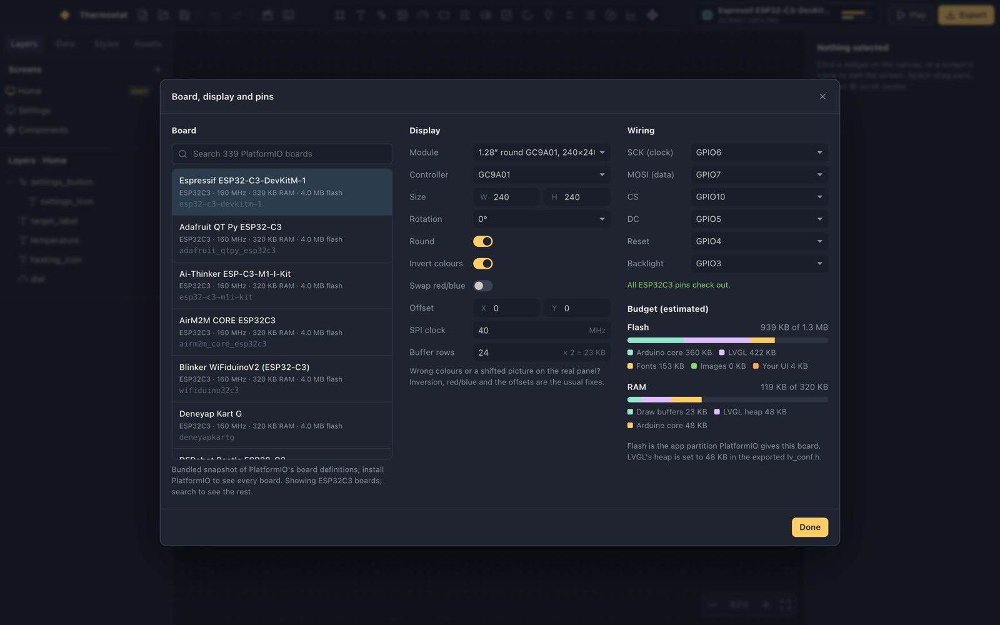
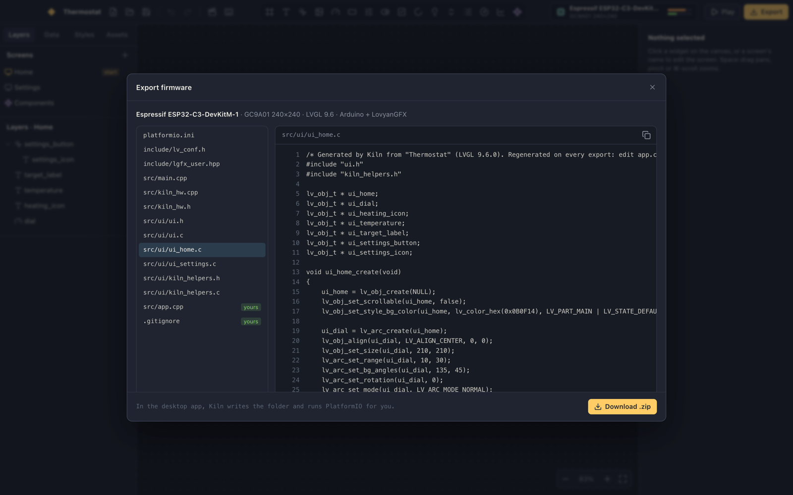

# Kiln

A Figma-style editor for microcontroller UIs. You design on an infinite canvas, wire widgets to
data coming off the board, and export plain LVGL 9.6 C inside a PlatformIO project that builds for an
ESP32-C3 with no edits.


The canvas isn't an imitation of LVGL: it **is** LVGL. Version 9.6 is compiled to WebAssembly and
renders every artboard, at the panel's RGB565 colour depth, with the fonts and theme the board gets.
What you see is what flashes.


## What it does

- **Work like Figma.** A home page holds the templates, the samples and your recent files, and each
  project opens in a tab of its own that keeps its undo history. The session comes back at launch.
  Light and dark themes follow macOS unless Settings (⌘,) picks one.
- **Design like Figma.** Screens sit side by side on an infinite canvas. Insert widgets, drag with
  smart guides, resize from any handle, nest with auto layout (flexbox), group, copy and paste,
  ⌥-drag to duplicate, undo everything. Click picks the top-level layer, double-click goes deeper (or
  edits text in place), ⌘-click goes deepest, and dragging on a screen's background draws a
  selection box. With several layers selected, the inspector edits what they share in one undo
  step, and what differs reads "Mixed". Panels resize from their edges, and the canvas stays sharp
  at any zoom. Align and distribute with Figma's keys (⌥A/D/W/S/H/V, ⌃⌥H/V); a single layer aligns in its parent through
  its LVGL align, so it stays put when the parent resizes. Make any layer a **component**: the main lives on a Components screen, and
  each instance can override its texts and point its bindings at different variables. Animate a
  main's layers and every instance follows.
- **Style like CSS.** Every LVGL style property, per part (`indicator`, `knob`…) and per state
  (`pressed`, `checked`… and combinations like `checked+pressed`). Shared styles work like classes,
  colour tokens like CSS variables, and transitions like `transition:`. Import your own TTF or OTF
  fonts and use them at any size, like `@font-face`: LVGL's TinyTTF draws them, on the canvas and on
  the board alike, straight from the font file in flash. LVGL's symbol icons keep working in them,
  borrowed from the built-in Montserrat.
- **Animate like the web.** A timeline with keyframes you drag along a ruler: `cubic-bezier`
  easing, delays, repeat and alternate, started when a screen loads or when something is tapped.
  Opacity, scale, rotation, translation, size and colour all animate.
- **Drop in sprites.** A GIF, a strip of square frames or numbered images becomes a frame
  animation: every frame an LVGL image, packed into a `const void *` frame array for
  `lv_animimg`, zoomed crisp like pixel art. "Make boot animation" turns one into a first screen
  that plays once, then opens your home screen.
- **Bind to the board.** Variables are LVGL subjects. Bind text, values, checked state, visibility,
  states, chart history, or any numeric style property mapped from one range to another. Feed a
  variable from an ADC pin, a digital pin, uptime, free heap, the chip's temperature or any C
  expression; let one drive a GPIO or PWM. Pins are checked against the MCU: ADC capability,
  strapping, flash and USB pins, double use.
- **Touch it, or press it.** Give the panel a touch chip (CST816S, FT6x36, GT911 or the resistive
  XPT2046, on the display's SPI bus or its own) and LovyanGFX feeds it to LVGL as a pointer, turned
  with the panel. Push buttons on GPIOs become an LVGL keypad: each screen keeps a focus group of its
  interactive widgets, "Next widget" moves through it and "Press" clicks what has focus, so a UI with
  no touch panel works on three buttons. Pick a dev kit (the ESP32-2424S012, Waveshare's round
  S3 touch board, the "Cheap Yellow Display", LilyGO's T-Display) and the board, panel, touch and
  buttons are all filled in. New projects start on the board you set up last, wiring and SPI clock
  included.
- **Play it.** Play mode runs the whole UI on real LVGL: taps, events, screen transitions,
  animations, and simulated sensors you can scrub. The board's buttons sit under the device and
  your keyboard stands in for them (Tab, Enter, arrows). With the Interact tab open, every navigation
  shows on the canvas as a prototype noodle, and dragging one from a widget to a screen makes it.
  Noodles enter the side of a screen that faces where they come from, spread out where they share a
  side, and keep a lane apart when two screens link both ways.
- **Export it.** `ui.h`, `ui.c` and one file per screen in readable LVGL C, an `lv_conf.h` with only
  the fonts you used, a LovyanGFX panel config, the hardware glue, and a `platformio.ini`. Your code
  goes in `src/app.cpp`, which Kiln writes once and never touches again. The output uses LVGL 9.6's
  current API (`lv_subject_create`, `lv_obj_set_hidden`…), so it compiles without a single warning.
- **Design once, for every screen** (experimental, on in Settings). Add sizes (a 128×160 ST7735 beside a round GC9A01, say),
  each with its own board and panel. Pick one and every screen shows at that size; LVGL's relative
  layout (align, %, flex) does most of the work, and anything you change there stays there, like
  a CSS media query: layout, style, visibility, and graphics (an image, a sprite, their zoom),
  since a different panel usually wants different art. Images are compiled in only where shown,
  so art one size uses costs the others nothing. Play, export and the budget follow the size you're on.
- **Build, flash and watch it.** In the desktop app, Build (⌘B) and Flash (⌘U) export the project
  and run `pio run` in the background, like PlatformIO in VS Code: keep designing while it compiles
  and uploads. The log streams into a panel under the canvas (⌘J) or a window of its own, and the
  toolbar shows esptool's progress. A serial monitor (⇧⌘M) reads the board, sends to it and resets
  it; it steps aside while a flash needs the port and reconnects after. A log file records builds
  and flashes (with the end of a failed build's output), the monitor's connections, PlatformIO,
  file errors, the page's errors and any crash; Help › Show Logs puts it in Finder, ready to attach
  to a bug report.
- **Know if it fits.** A flash and RAM meter estimates the build against the board's real limits,
  read from PlatformIO's board definitions, counting fonts, images and TinyTTF's glyph caches.
  LVGL draws a rotated or scaled widget through a layer on its heap, which the preview's roomy heap
  would never show; Kiln sizes the board's heap for the biggest one and says which widget it is.

| Components                         | Board, display and pins         | Export                     |
| ---------------------------------- | ------------------------------- | -------------------------- |
|  |  |  |

## Getting started

You need Node 22+, pnpm, and Rust (for the Tauri shell).

```sh
pnpm install
pnpm tauri dev      # the desktop app
pnpm dev            # or just the editor, in a browser at localhost:1420
```

[PlatformIO Core](https://platformio.org/install/cli) is optional. With it, the board list comes
from your installed PlatformIO, and Export can build and flash straight from the app. Without it,
Kiln uses a bundled snapshot of PlatformIO's ESP32, RP2040 and SAMD boards.

## How it fits together

```
document (zustand + immer) ──compile()──► op list ──► wasm LVGL     (the canvas and Play)
                                                  └─► C printer    (the export)
```

One function, `compile()` in `src/entities/project/lib/compile.ts`, turns the document into a list of
LVGL calls. The preview executes that list on LVGL in WebAssembly; the exporter prints the same list
as C. The canvas and the firmware can't drift apart because they're the same instructions.

The small amount of glue both sides need (colour and style animations, mapped bindings, chart
history) lives in `runtime/kiln_helpers.c`, which is compiled into the preview and copied into every
export.

The frontend follows [Feature-Sliced Design](https://feature-sliced.design), checked by Steiger:

| Layer      | What's there                                                                                                                                             |
| ---------- | -------------------------------------------------------------------------------------------------------------------------------------------------------- |
| `app`      | entry point, global styles, theme, the menu bar's commands                                                                                               |
| `pages`    | `editor` (layout and keyboard shortcuts), `home` (templates and recents), `output` (the output window)                                                   |
| `widgets`  | canvas, layers, inspector, data, styles, assets, timeline, player, tab bar, output panel, dialogs                                                        |
| `features` | insert widget, node actions, history, project files and tabs, firmware export and builds                                                                 |
| `entities` | `project` (document, compiler, preview), `board` (PlatformIO boards, pins, budget), `device` (builds and the serial monitor), `editor` (selection, view) |
| `shared`   | `lvgl` (catalog, ops, wasm runtime, C printer), `ui` kit, Tauri bridge                                                                                   |

Each slice is MVVM: views in `ui/` stay dumb and read a view-model hook in `model/` (for example
`useCanvas`, `useInspector`, `useLayers`), which is the only thing that talks to the stores.

## The LVGL runtime

`src/shared/lvgl/runtime/kiln-rt.wasm` is checked in, so you don't need a C toolchain to work on the
editor. To rebuild it (after adding a new LVGL constant to the TypeScript, say):

```sh
pnpm run runtime
```

That fetches LVGL 9.6.0 into `runtime/lvgl` and compiles it with clang's `wasm32` target. It doesn't use
Emscripten: LVGL's built-in allocator, string and printf functions mean it needs no libc. It links
with `wasm-ld`, or with the `rust-lld` every rustup toolchain ships.

## Checks

```sh
pnpm check                 # typecheck, Steiger, and the vitest suite
cd src-tauri && cargo test # the Rust file-writing guards
```

The suite runs the sample project on the real wasm LVGL (bindings, taps, screen loads). A
"kitchen sink" project uses every widget, binding, action, animated property, image format and
component feature; it plays on the wasm LVGL without a logged error, and its export compiles against
the LVGL 9.6 headers with clang, failing on any deprecated API. Both the sample and the kitchen sink
have also been built with `pio run` for `esp32-c3-devkitm-1` (958 KB and 814 KB, 31% RAM), with no
warnings from the generated code. A 4 MB ESP32 builds with `huge_app.csv`, so the app gets 3 MB of
the chip instead of the default table's 1.25 MB; there's no OTA slot, since Kiln flashes over USB.

CI (`.github/workflows/ci.yml`) runs the same checks plus the production build and the Rust tests.

## Opening files you didn't make

A `.kiln` file turns into C that gets compiled and a `platformio.ini` that `pio` runs, so Kiln
treats project files as untrusted: board ids are checked on open, and everything that reaches
generated code is validated (catalog enums, `#rrggbb` colours, finite numbers, comment-safe text).
The one deliberate exception is a variable's **C expression** source, which is pasted into the
firmware as written; that's its job. Read those before building someone else's project.

## Status

See [GOALS.md](GOALS.md). Michael has flashed the thermostat sample to an ESP32-C3 with a round
GC9A01 panel, built and uploaded from Kiln. Display init (inversion, colour order, offsets) is
still the first thing to check on a new panel, and every one of those settings is a toggle in the
board dialog.
